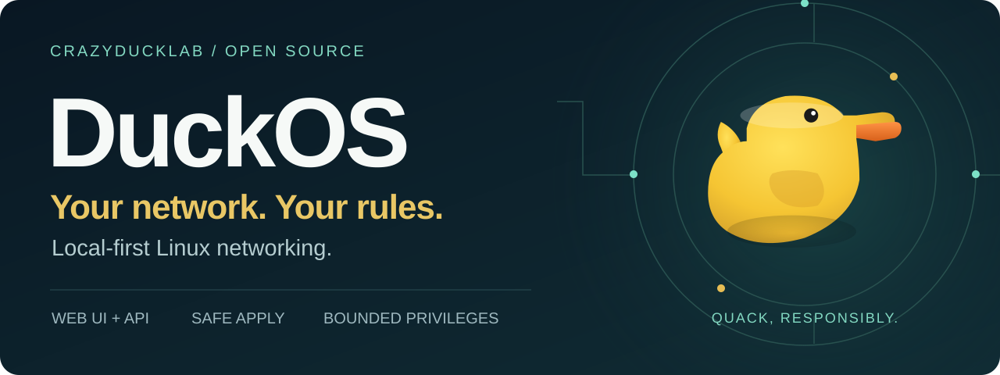
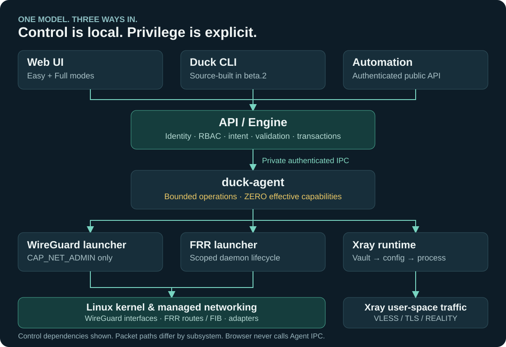
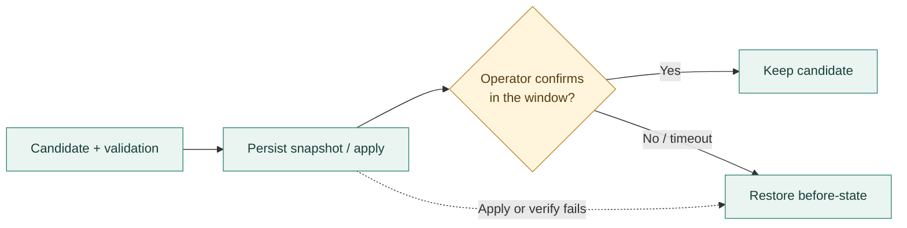

<p align="center">
  
</p>

<h1 align="center">DuckOS</h1>

<p align="center">
  <strong>A local-first Linux network operating platform for routers, gateways and edge nodes.</strong><br>
  Web UI · authenticated API · source-built CLI · Safe Apply · WireGuard · Xray · FRR
</p>

<p align="center">
  <a href="https://github.com/CrazyDuckLab/DuckOS/releases/tag/v0.1.0-beta.2"></a>
  <a href="https://github.com/CrazyDuckLab/DuckOS/actions/workflows/verify.yml"></a>
  <a href="LICENSE"></a>
  <a href="docs/install.md"></a>
  <a href="docs/compatibility.md"></a>
  <a href="docs/README.md"></a>
</p>

<p align="center">
  <a href="#quick-start"><strong>Quick start</strong></a> ·
  <a href="#inside-duckos">Architecture</a> ·
  <a href="#what-ships">Features</a> ·
  <a href="#the-interface">Interface</a> ·
  <a href="docs/README.md">Documentation</a> ·
  <a href="docs/roadmap.md">Roadmap</a>
</p>

> **v0.1.0-beta.2 is a published prerelease. Fresh installation only.**
> AMD64 has two-node live qualification; ARM64 and ARMv7 have official builds and
> artifact verification, without the equivalent live matrix. Use an isolated
> evaluation network and console access. No qualified beta.1 → beta.2 upgrade.

## Networking you can inspect

DuckOS brings configuration, diagnostics and recovery into one local control
plane on **Debian 13 with systemd**. Easy and Full modes use the same declarative
model. IPv4 and IPv6 are first-class inputs; intent, configured state, observations
and verification remain distinct. No mandatory cloud account or SaaS dependency.

**Explain why. Show the operation. Confirm the change.** Network health is more
than a reachable API. The interface keeps missing evidence visible, and Safe Apply
retains a confirmation window and rollback path.

DuckOS installs onto an existing Linux host. The beta.2 archives are installer
payloads, not bootable system images or firmware for arbitrary consumer routers.

## What ships

| Area | Beta.2 capabilities | Evidence boundary |
|---|---|---|
| **Networking & tunnels** | WireGuard servers/peers; Xray **26.3.27**, VLESS/TLS and REALITY; FRR launcher and BGP | **Qualified on AMD64** for the recorded tunnel/traffic scenarios and FRR H10 advertise/withdraw/restart |
| **Configuration & recovery** | Declarative network objects, Safe Apply, durable journal, management protection and boot recovery | **Implemented**, with targeted AMD64 recovery evidence; the whole networking catalog is not a qualified workflow matrix |
| **Identity & operator experience** | Owner enrollment, sessions, RBAC, Vault-backed materialization; Easy / Full UI; EN · RU · DE · ES | **Implemented**; `duck` CLI is separately source-built and is not installed by the archive |
| **Diagnostics & device actions** | Doctor, inspectable observations, Speed Lab and Wake-on-LAN | **Implemented**; bounded Speed Lab probes and SSRF refusals **qualified on AMD64** |
| **Port Mapping** | Backend, Trusted LAN Registry, nftables lifecycle, TTL, revoke and cleanup | **Backend available**; UPnP IGD, SSDP/M-SEARCH, NAT-PMP and PCP frontends are **planned, not shipped** |

**Implemented ≠ observed ≠ verified ≠ qualified.** A UI entry alone proves none
of those. This prerelease is for evaluation; experimental or unqualified paths
remain outside the stated live evidence. [Read the qualification summary](docs/qualification-beta2.md)
and [complete limitations](docs/beta-limitations.md).

## Inside DuckOS

<p align="center">
  
</p>

The diagram shows selected control dependencies. Linux processes packets;
WireGuard uses kernel interfaces, FRR controls routing, and Xray carries traffic
in user space. They have different runtime paths.

- **One public boundary.** UI and ordinary CLI/API operations enter the Engine's
  authenticated semantic path. The browser never calls Agent IPC.
- **Capabilities stay explicit.** `duck-agent` has zero effective Linux
  capabilities. `duck-wg-launcher` has only `CAP_NET_ADMIN`; FRR has its own bounded
  launcher and scoped daemon lifecycle.
- **Secrets stay behind the boundary.** Xray configuration materializes through
  the protected Vault path, keeping runtime secret resolution on the host.

[Open the full-size overview](docs/assets/presentation/platform.svg) ·
[Explore the control and packet paths](docs/platform-overview.md) ·
[Architecture](docs/architecture.md) · [Security model](docs/security-model.md)

### A change has to earn its place



The independent watchdog and durable journal preserve the recovery path when
an apply is not confirmed. Rollback failure stays visible; console access still
matters. This is a workflow illustration, not an additional transaction-state enum.
[Safe Apply](docs/user/safe-apply.md) · [Recovery](docs/user/recovery.md)

## The interface

**Two modes. One configuration model.** Easy Mode offers an overview; Full Mode
opens up the technical detail. Global search and contextual help connect the two.

These are **authentic historical beta.1 captures**, not current beta.2 screenshots.
They illustrate the interface and do not establish beta.2 feature readiness.
[Capture provenance](docs/assets/screenshots/README.md).


<details>
<summary><strong>Open Full Mode / System Overview</strong></summary>


The explicit “Status incomplete” headline is intentional: API reachability does
not prove network health.

</details>

## Quick start

**Start with a fresh Debian 13 host, an isolated network and out-of-band console
access.** Installation requires administrator privileges. Keep the management
interface intact.

**1 · Choose the build.** Check `uname -m` and `dpkg --print-architecture`.

| Host | Archive suffix | Beta.2 evidence |
|---|---|---|
| `x86_64` / `amd64` | `amd64` | Build, artifact verification and two-node live qualification |
| `aarch64` / `arm64` | `arm64` | Build and artifact verification |
| `armv7l` / `armhf` | `armv7` | Build and artifact verification; Go target is `arm` with `GOARM=7` |

**2 · Download and verify.** Set `ARCH` to the matching suffix.

```bash
ARCH=amd64
ARCHIVE="duckos-v0.1.0-beta.2-linux-${ARCH}.tar.gz"
BASE=https://github.com/CrazyDuckLab/DuckOS/releases/download/v0.1.0-beta.2
curl --fail --location --output "$ARCHIVE" "$BASE/$ARCHIVE"
curl --fail --location --output SHA256SUMS "$BASE/SHA256SUMS"
sha256sum --check --ignore-missing SHA256SUMS
```

Require an **OK** result for the selected archive. Checksums detect corruption;
they do not independently authenticate the publisher.

**3 · Stage, preflight, install.** Follow the [installation guide](docs/install.md)
for prerequisites, extraction and **root-owned staging**. Once that staging is
complete, the supported commands are:

```bash
sudo bash /root/duckos-install/duckos-v0.1.0-beta.2/install.sh   --artifact /root/duckos-install/duckos-v0.1.0-beta.2 --check
sudo bash /root/duckos-install/duckos-v0.1.0-beta.2/install.sh   --artifact /root/duckos-install/duckos-v0.1.0-beta.2
```

**4 · Enroll the Owner.** Forward the loopback management listener from your
administrator workstation:

```bash
ssh -N -L 8080:127.0.0.1:8080 <user>@<duckos-ip>
```

Open `http://127.0.0.1:8080` and complete [Owner enrollment](docs/user/getting-started.md).
Read the bootstrap credential privately on the host when prompted. Never post
it in issues or logs. There is no automatic LAN HTTPS onboarding or mDNS discovery.

[Download beta.2](https://github.com/CrazyDuckLab/DuckOS/releases/tag/v0.1.0-beta.2) ·
[Installation guide](docs/install.md) · [CLI/API availability](docs/cli-api.md) ·
[Troubleshooting](docs/troubleshooting.md)

## Where the flock is headed

The next work is about deeper operator workflows and broader deployment evidence.
This direction is **provisional**: no dates, completed beta.3 work or hardware
qualification are promised.


[Explore the roadmap](docs/roadmap.md). Multi-WAN, split tunneling, QoS/SQM,
Wi-Fi, OTA delivery and system images are future development/qualification work,
not beta.2 support claims. Physical ODROID-XU4 was not in final beta.2 qualification.

## Find your next step

| Operate | Understand | Contribute |
|---|---|---|
| [Installation](docs/install.md) | [Platform overview](docs/platform-overview.md) | [Development](docs/development.md) |
| [User guide](docs/user/README.md) | [Architecture](docs/architecture.md) | [Contributing](CONTRIBUTING.md) |
| [CLI / API](docs/cli-api.md) | [Security model](docs/security-model.md) | [Report a bug](https://github.com/CrazyDuckLab/DuckOS/issues/new/choose) |
| [Troubleshooting](docs/troubleshooting.md) | [Qualification](docs/qualification-beta2.md) | [Community conduct](CODE_OF_CONDUCT.md) |
| [Recovery](docs/user/recovery.md) | [Limitations](docs/beta-limitations.md) | [Release notes](docs/release-notes.md) |

[Full documentation index](docs/README.md) · [Changelog](CHANGELOG.md) ·
[Report a vulnerability privately](SECURITY.md)

## Built in the open

DuckOS Community source is **[GPL-3.0-only](LICENSE)**. Branding has its own
[trademark policy](TRADEMARKS.md); contributor rights follow the
[draft CLA](CLA.md). Issues, testing reports and documentation feedback are
welcome; external code contributions remain gated by that draft policy.

For source work, start with [the pinned toolchain and development guide](docs/development.md).
The complete `make check` suite runs on Linux; cross-build success alone does
not establish runtime or hardware qualification.

<p align="center"><strong>CrazyDuckLab</strong> · Small duck. Explicit boundaries.</p>
