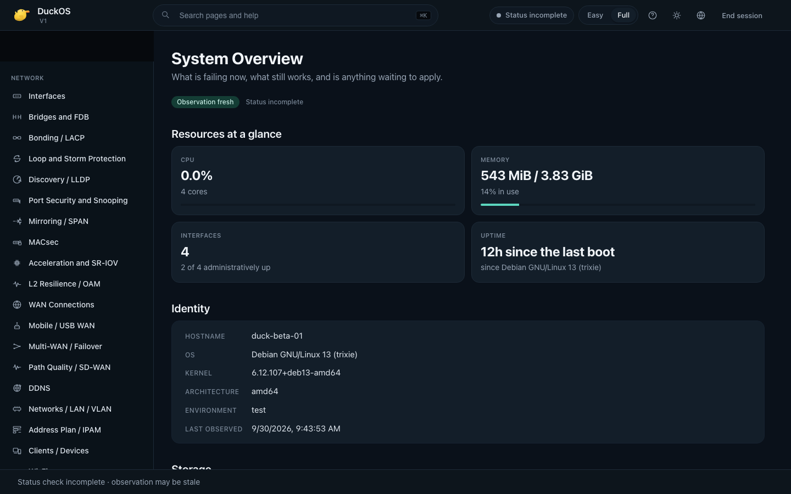

# DuckOS

**A local-first Linux network operating platform for routers, gateways, VPS / edge nodes and self-hosted appliances.**

DuckOS brings network management, diagnostics and recovery into a web interface
on Debian 13 with systemd, without a mandatory cloud service. The Web UI and
authenticated API share a declarative, intent-based configuration model. A
source-built CLI uses the same API; the beta.2 archive does not install `duck`.

**v0.1.0-beta.2 is beta software and fresh-install-only.** There is no qualified
in-place upgrade from beta.1. Evaluate it on an isolated network with console
access; it is not a production-ready router release.

## Design principles

Local operation, IPv4/IPv6 configuration, inspectable diagnostics and explicit
desired/observed/verified states guide the architecture. Safe Apply requires
confirmation and retains a rollback path. Contextual explanations and CLI/API
references help operators inspect actions before applying them. Implemented
controls and qualified workflows are distinguished in the [limitations](docs/beta-limitations.md).

```text
Web UI / source-built CLI → authenticated API / Engine → local Agent IPC
                                                       → bounded launchers → Linux
```

See [architecture](docs/architecture.md) and [security](docs/security-model.md).

## Beta.2 highlights

- Official Linux AMD64, ARM64 and ARMv7 release artifacts.
- Bundled xray-core **26.3.27**, with real VLESS/TLS and VLESS/REALITY client
  traffic qualified on AMD64 and Vault-backed credential materialization.
- WireGuard privileged launcher, with two simultaneous tunnels qualified
  between two nodes. `duck-agent` has zero Linux capabilities;
  `duck-wg-launcher` has only `CAP_NET_ADMIN`.
- FRR privileged launcher and improved systemd, IPC and reboot reliability.
- Port Mapping backend, Trusted LAN Registry, nftables mapping lifecycle,
  TTL, revoke and cleanup; Wake-on-LAN and Speed Lab.
- RBAC and network-object fixes; Easy / Full UI improvements;
  English, Russian, German and Spanish.

## Interface preview

Authentic historical beta.1 capture of System Overview; this illustrates the
interface, not beta.2 qualification or complete feature availability.



## Choose your platform

| Host architecture (`uname -m`) | Release archive | Build/artifact verification | Complete beta.2 live matrix |
|---|---|---|---|
| `x86_64` | `duckos-v0.1.0-beta.2-linux-amd64.tar.gz` | Yes | Yes, two Debian 13 VMs |
| `aarch64` / `arm64` | `duckos-v0.1.0-beta.2-linux-arm64.tar.gz` | Yes | No |
| `armv7l` | `duckos-v0.1.0-beta.2-linux-armv7.tar.gz` | Yes | No |

ARMv7 uses `GOARCH=arm GOARM=7`. ARM64 and ARMv7 are official release targets;
they did not receive the complete AMD64 live matrix. Physical ODROID XU4
qualification is not part of beta.2. See [compatibility](docs/compatibility.md).

## Install

Start with a **fresh Debian 13 host** matching the archive. Download your archive
and `SHA256SUMS` from the [beta.2 release](https://github.com/CrazyDuckLab/DuckOS/releases/tag/v0.1.0-beta.2).
The [installation guide](docs/install.md) covers architecture selection, download,
SHA-256 verification, root-owned staging, prerequisites and the supported installer:

```bash
sudo bash /root/duckos-install/duckos-v0.1.0-beta.2/install.sh \
  --artifact /root/duckos-install/duckos-v0.1.0-beta.2 --check
sudo bash /root/duckos-install/duckos-v0.1.0-beta.2/install.sh \
  --artifact /root/duckos-install/duckos-v0.1.0-beta.2
```

Access the dashboard through an administrator-controlled SSH tunnel:

```bash
ssh -N -L 8080:127.0.0.1:8080 <user>@<duckos-ip>
```

Open `http://127.0.0.1:8080` and complete [Owner enrollment](docs/user/getting-started.md).
Management remains on loopback; the Agent uses private local IPC.

## Current limitations

- Beta software; fresh installation required; no qualified beta.1 → beta.2 upgrade.
- No UPnP IGD, SSDP/M-SEARCH, NAT-PMP or PCP network protocol frontends.
- ARM64 / ARMv7 have build and artifact evidence, not the complete AMD64 live matrix.
- FRR live BGP advertise/withdraw/restart passed on AMD64; other routing protocols
  and arbitrary hardware are outside that qualification.
- No public OTA channel, automatic LAN HTTPS onboarding or mDNS discovery.
- Hardware, Wi-Fi chipset and power-loss behavior require additional evidence.

See [beta limitations](docs/beta-limitations.md) and [release notes](docs/release-notes.md).
Safe Apply, explicit confirmation and management protection remain required;
a reachable API alone is not proof that the network is healthy.

## Documentation and help

- [Installation](docs/install.md) · [Getting started](docs/user/getting-started.md)
- [User guide](docs/user/README.md) · [Documentation index](docs/README.md)
- [Architecture](docs/architecture.md) · [Security model](docs/security-model.md)
- [Changelog](CHANGELOG.md) · [Release notes](docs/release-notes.md)
- [Current qualification summary](docs/qualification-beta2.md) · [Historical evidence](beta2-final-report.md)
- [CLI and API](docs/cli-api.md)
- [Troubleshooting](docs/troubleshooting.md)

Report bugs through the repository issue templates with sanitized logs and build
identity. Report vulnerabilities according to [SECURITY.md](SECURITY.md).
Never publish credentials, private keys, subscription URLs or session data.

## Development and license

```bash
bash scripts/bootstrap.sh
make deps
make check
make build-all
```

Run the full `make check` suite on Linux; macOS supports cross-builds and
portable checks. Pinned tools live inside the checkout. Artifacts record full source identity in
`BUILD-INFO.json`; runtime `VERSION` is `1.0.0-dev.<12-character-commit>`.
The public beta name is separate from that internal build identifier.

Source is [GPL-3.0-only](LICENSE). See [COPYRIGHT.md](COPYRIGHT.md),
[TRADEMARKS.md](TRADEMARKS.md) and [licensing](docs/licensing.md).
[CONTRIBUTING.md](CONTRIBUTING.md) and [AGENTS.md](AGENTS.md) cover engineering
policy; external code contributions remain subject to the draft [CLA](CLA.md).
Historical beta.1 screenshots remain indexed in [the screenshot guide](docs/assets/screenshots/README.md).
