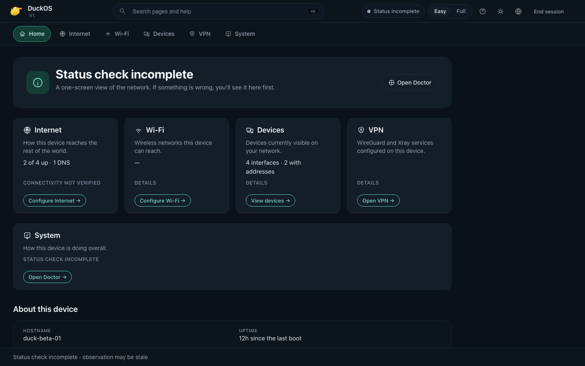
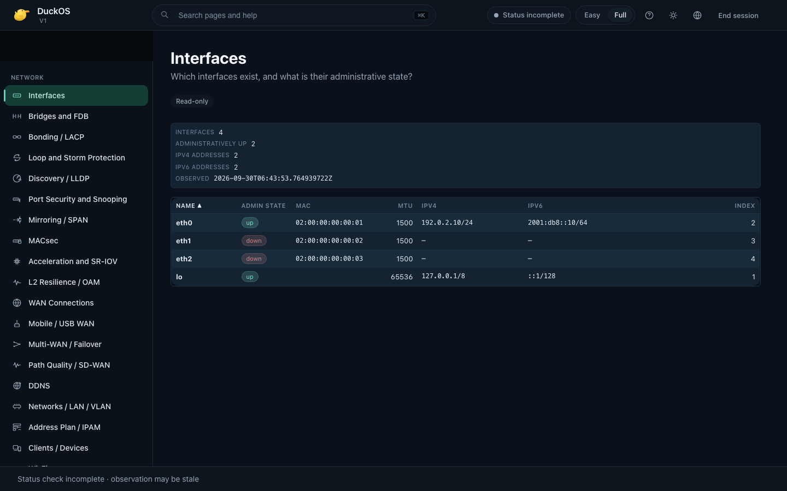
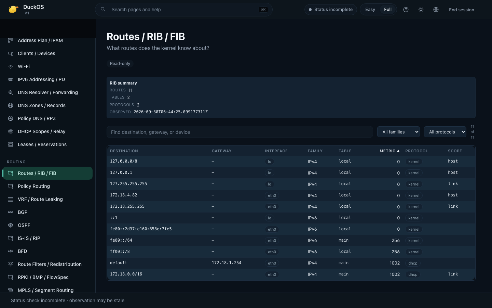
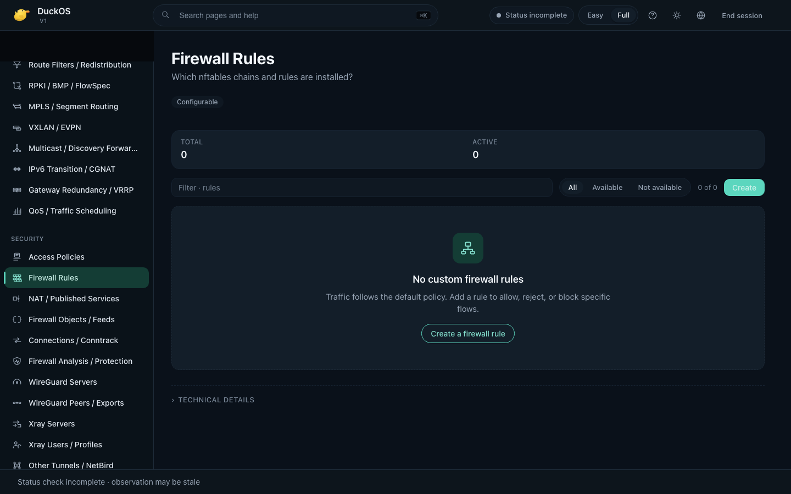
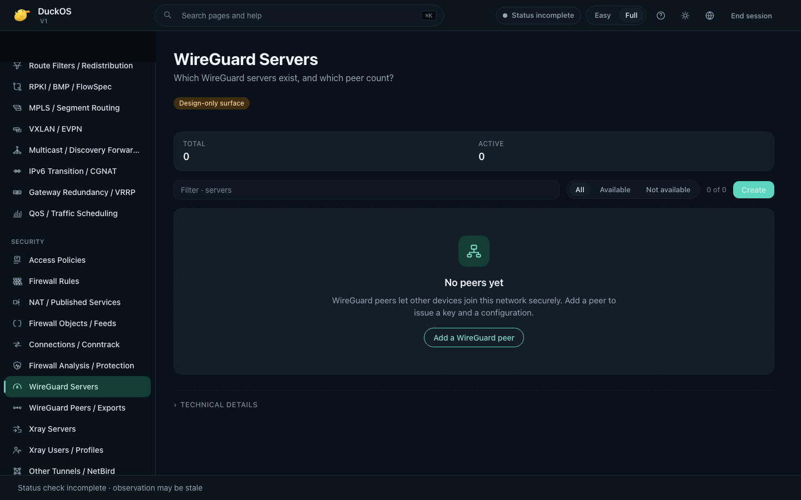
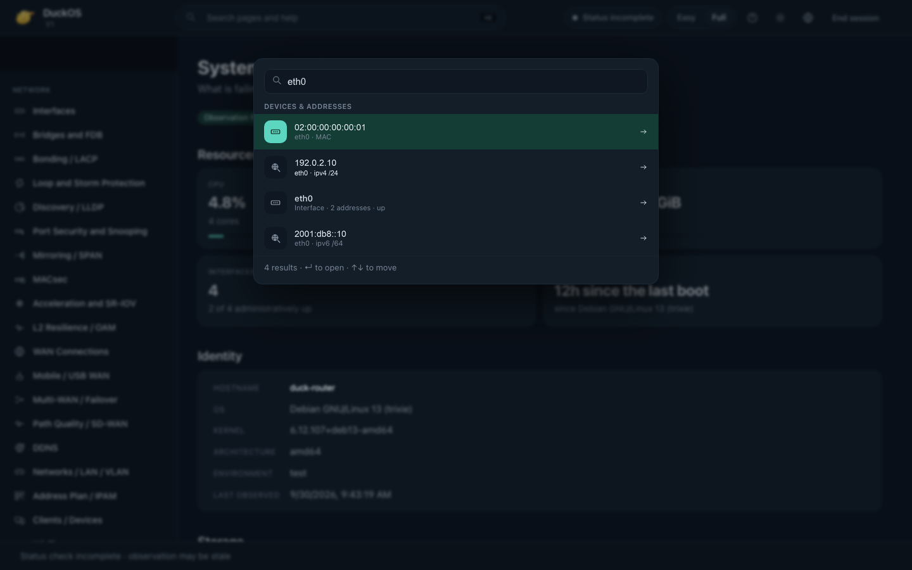
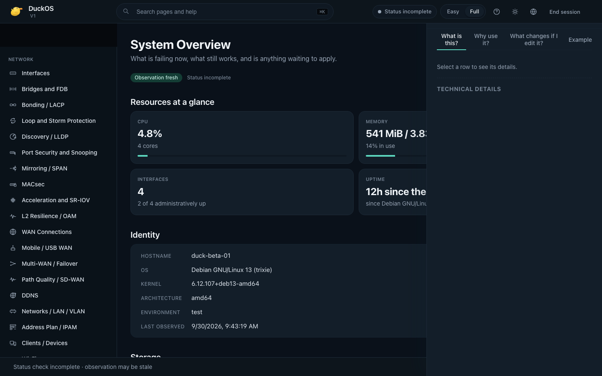
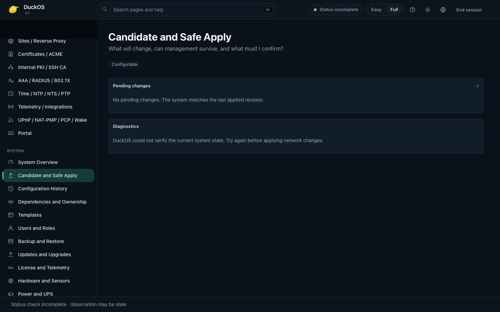
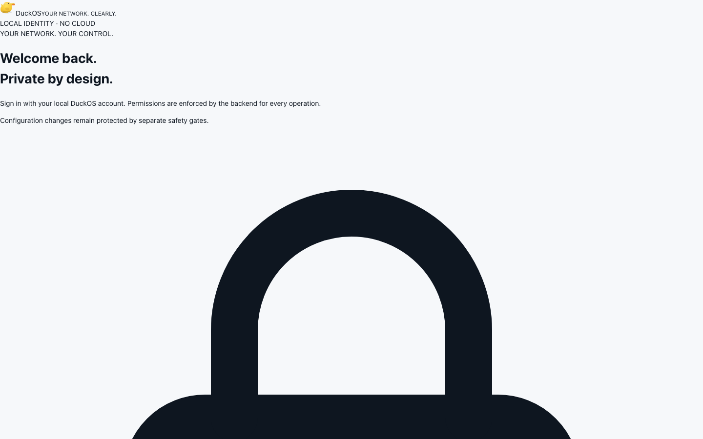

# DuckOS

**Local-first network operating platform for routers, gateways, VPS / edge nodes and self-hosted network appliances.**

[](LICENSE)
[](docs/beta-limitations.md)
[](docs/release-notes.md)
[](docs/install.md)
[](docs/release-notes.md)
[](docs/privacy-network-egress.md)

## What is DuckOS?

DuckOS is a Linux network operating platform that brings network
management and recovery into a modern web interface above a supported
Debian 13 amd64 host. It is designed for home networks, homelabs, and
small-business administrators who want one configuration lifecycle
across different hardware without depending on a cloud service.

**Current status:** `v0.1.0-beta.1` — first public beta of DuckOS V1.
The Easy Mode home, Full Mode navigation, first Owner enrollment,
password login, the privileged Agent / Engine / API boundary, Safe
Apply journaling, Doctor diagnostics, the update supervisor with
Active + Previous invariant, and the SSH local-forward admin tunnel
are wired up and observed on real Debian 13 amd64 hosts. The V1 beta
is **not** a production router OS and is **not** an enterprise firewall
yet — see [`docs/beta-limitations.md`](docs/beta-limitations.md) for
what is and is not wired up to live activation in this beta.



## Why DuckOS?

- **One lifecycle.** Configuration passes through one canonical pipeline:
  observe the live kernel → propose a candidate → review a Diff → Apply →
  verify → Confirm. Auto-confirm does not exist.
- **Local-first.** The Agent and API run on the device itself and bind
  only `127.0.0.1:8080`. There is no required cloud service, no
  required HTTPS interception, no telemetry endpoint. See
  [`docs/privacy-network-egress.md`](docs/privacy-network-egress.md).
- **Anti-lockout by construction.** The validation pipeline refuses to
  remove the management anchor from the active set. There is no
  override. Recovery primitives ship in the artifact; see
  [`docs/user/recovery.md`](docs/user/recovery.md).
- **Honest health.** The headline distinguishes **Needs attention**,
  **Status incomplete**, and **Unavailable**. The UI never claims
  **Healthy** or **Observation fresh** without real evidence.

## Try the beta

A user-friendly path to install the released binary. For the full
qualified procedure see [`docs/install.md`](docs/install.md); for the
walkthrough including SSH local-forward and Owner enrollment see
[`docs/user/getting-started.md`](docs/user/getting-started.md).

1. **Verify the artifact.** On the workstation that has the release
   files, run:

   ```bash
   sha256sum -c SHA256SUMS
   ```

   Expected line for v0.1.0-beta.1:

   ```
   ae5d21aa19e3b39efaee1ba070158781df4aae5605adae096b8563f241dcdc7d  duckos-v0.1.0-beta.1-linux-amd64.tar.gz
   ```

2. **Extract and install on a fresh Debian 13 amd64 host.**

   ```bash
   tar -xzf duckos-v0.1.0-beta.1-linux-amd64.tar.gz
   cd duckos-v0.1.0-beta.1
   sudo bash install.sh --artifact "$(pwd -P)"
   ```

   The installer only accepts a fresh Debian 13 amd64 host with systemd
   and refuses any pre-existing DuckOS installation.

3. **Reach the dashboard through an SSH tunnel.** The V1 beta binds
   only `127.0.0.1:8080`:

   ```bash
   ssh -L 8080:127.0.0.1:8080 <user>@<duckos-ip>
   ```

   Then open `http://127.0.0.1:8080` in a modern Chromium or Firefox
   browser.

4. **Complete first-time Owner enrollment.** The bootstrap API token
   lives at `/etc/duckos/api-token` on the device. Paste it once into
   the first-run screen, choose a username and a strong passphrase
   (15–128 characters; the server does not enforce a minimum), and
   submit. After enrollment, the browser holds a session credential in
   `sessionStorage`.

## What's wired up in v0.1.0-beta.1

| Capability | Status in v0.1.0-beta.1 |
|---|---|
| First Owner enrollment, password login, RBAC, expiring / revocable sessions | Available |
| Easy Mode home, Full Mode navigation, global search (`⌘K` / `Ctrl+K`), Inspector pane (`?`) | Available |
| Real-time observation of interfaces, addresses, routes, DNS, DHCP, nftables, FRR | Available (read-only) |
| Doctor / diagnostics with deterministic findings | Available (read-only) |
| Audit log and sessions management | Available |
| Safe Apply journaling with rollback watchdog and pre-networkd boot recovery unit | Available for the qualified network-renderer path |
| Configuration write / commit through the public web UI | Not wired up in this beta |
| Multi-WAN, WireGuard, Xray, NetBird live activation | Not wired up in this beta |
| mDNS / DNS-SD onboarding, LAN HTTPS, public OTA | Not part of this beta |
| ARM64 / ARMv7 native qualification | Reference / cross-build only on this beta |

See [`docs/compatibility.md`](docs/compatibility.md) for the full
QUALIFIED / REFERENCE / EXPECTED BUT NOT QUALIFIED / NOT CURRENTLY
SUPPORTED matrix, and [`docs/beta-limitations.md`](docs/beta-limitations.md)
for the runtime list of what is and is not wired up.

## Screenshots

Real captures against the installed `v0.1.0-beta.1` RC on a clean
Debian 13 amd64 VM. No concept art, no mock UI, no static fake JSON.
See [`docs/assets/screenshots/README.md`](docs/assets/screenshots/README.md)
for the full index.

| Page | Screenshot |
|---|---|
| Easy Mode home |  |
| Full Mode System Overview |  |
| Full Mode Network → Interfaces |  |
| Full Mode Network → Routing |  |
| Full Mode Security → Firewall |  |
| Full Mode Security → WireGuard |  |
| Global search |  |
| Inspector pane |  |
| Safe Apply |  |
| First-run Owner enrollment |  |

## Documentation

- [`docs/install.md`](docs/install.md) — qualified installation flow.
- [`docs/user/getting-started.md`](docs/user/getting-started.md) — first
  Owner enrollment and SSH local-forward walkthrough.
- [`docs/user/README.md`](docs/user/README.md) — user guide index.
- [`docs/README.md`](docs/README.md) — full documentation index.
- [`docs/architecture.md`](docs/architecture.md) — API, Engine,
  privileged Agent and Linux boundaries.
- [`docs/product-spec-1.0.md`](docs/product-spec-1.0.md) — frozen V1
  specification.
- [`docs/security-model.md`](docs/security-model.md) — trust,
  management, identity and secrets.
- [`docs/compatibility.md`](docs/compatibility.md) — qualified /
  reference / unsupported matrix.
- [`docs/beta-limitations.md`](docs/beta-limitations.md) — what is and
  is not wired up in v0.1.0-beta.1.
- [`docs/release-notes.md`](docs/release-notes.md) — release record.
- [`docs/privacy-network-egress.md`](docs/privacy-network-egress.md) —
  evidence-backed privacy and network-egress summary.
- [`docs/ai/README.md`](docs/ai/README.md) — AI / automation assistant
  guide.

## Security

Read [`docs/security-model.md`](docs/security-model.md) and
[`SECURITY.md`](SECURITY.md). Never publish private keys, passwords,
client QR payloads, subscription URLs / tokens, or sensitive network
details in issues. Management listeners are not automatically exposed
publicly; the dashboard is reachable only through an authenticated
SSH local-forward from an administrator you control.

## Contributing

[`CONTRIBUTING.md`](CONTRIBUTING.md) describes engineering rules, tests
and review. Issue templates cover bugs, features, installation,
hardware and documentation. Test results identify the exact build and
distinguish native, virtualized and cross-build evidence. Code
contributions are not accepted under the current `CLA.md` draft.

## License

DuckOS Community source is distributed under the **GNU General Public
License version 3 — only** (`GPL-3.0-only`). See
[`LICENSE`](LICENSE) for the canonical text.

- [`LICENSE`](LICENSE) — canonical `GPL-3.0-only` text.
- [`COPYRIGHT.md`](COPYRIGHT.md) — authorship and trademark separation.
- [`CLA.md`](CLA.md) — **DRAFT** contributor license agreement (code
  contributions are not accepted under this draft).
- [`TRADEMARKS.md`](TRADEMARKS.md) — DuckOS name, wordmark, and
  rubber-duck logo use.
- [`docs/licensing.md`](docs/licensing.md) — commercial /
  dual-licensing narrative.

The license applies to source code in this repository from the moment
each commit is published; already-distributed copies remain under the
license in force at the time they were received.

## Build identity

This repository's current `main` HEAD carries the qualified beta.1
source plus a docs-only commit on top. The authoritative **release
identity** is:

- **Release tag (eventual):** `v0.1.0-beta.1`
- **Qualified source commit:** `f698de16b4a90c52d7bd5b50f287ad01f36da5f3`
- **Internal runtime build:** `1.0.0-dev.f698de16b4a9`
- **Artifact SHA-256:** `ae5d21aa19e3b39efaee1ba070158781df4aae5605adae096b8563f241dcdc7d`

The `v0.1.0-beta.1` identifier is the public release name (the Git
tag and the downloadable filename). The runtime reports the qualified
internal identifier `1.0.0-dev.f698de16b4a9` exactly as it did
throughout qualification — this is intentional and not an error.

## Development / Build from source

If you want to build DuckOS yourself rather than download a release
artifact, the supported path lives in the source tree:

```sh
bash scripts/bootstrap.sh   # pinned tools inside .tools/; no system install
make deps
make check
make build-all             # production UI assets and Linux cross-builds
```

The pinned toolchain (Go 1.27.1, Node 24.20.0, npm 11.19.0) downloads
into `.tools/`; no system-wide install is performed. The same
`install.sh` used by the released artifact can then be exercised
against the local `dist/duckos-linux-amd64/` build output.

`AGENTS.md` is the engineering policy for coding agents working in
this source tree.

## What this release is NOT

- Not a public production release.
- Not feature-complete.
- Not a substitute for the qualification work described in
  [`docs/beta-limitations.md`](docs/beta-limitations.md) and
  [`docs/compatibility.md`](docs/compatibility.md).
- Not an announcement of a future central management / controller
  product.

What this release **is**: a real Debian 13 amd64 install image of
DuckOS V1, with an Easy Mode dashboard, a Full Mode navigation, Safe
Apply journaling, first Owner enrollment, audit logging, Doctor
diagnostics and the pre-networkd boot recovery unit, qualified to the
extent documented in
[`docs/beta-limitations.md`](docs/beta-limitations.md).