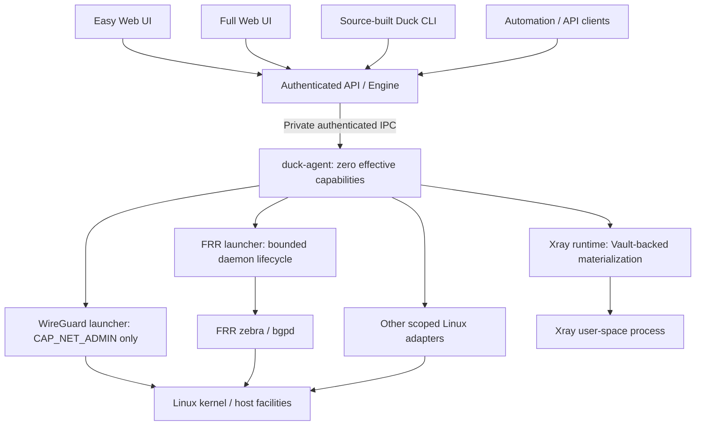
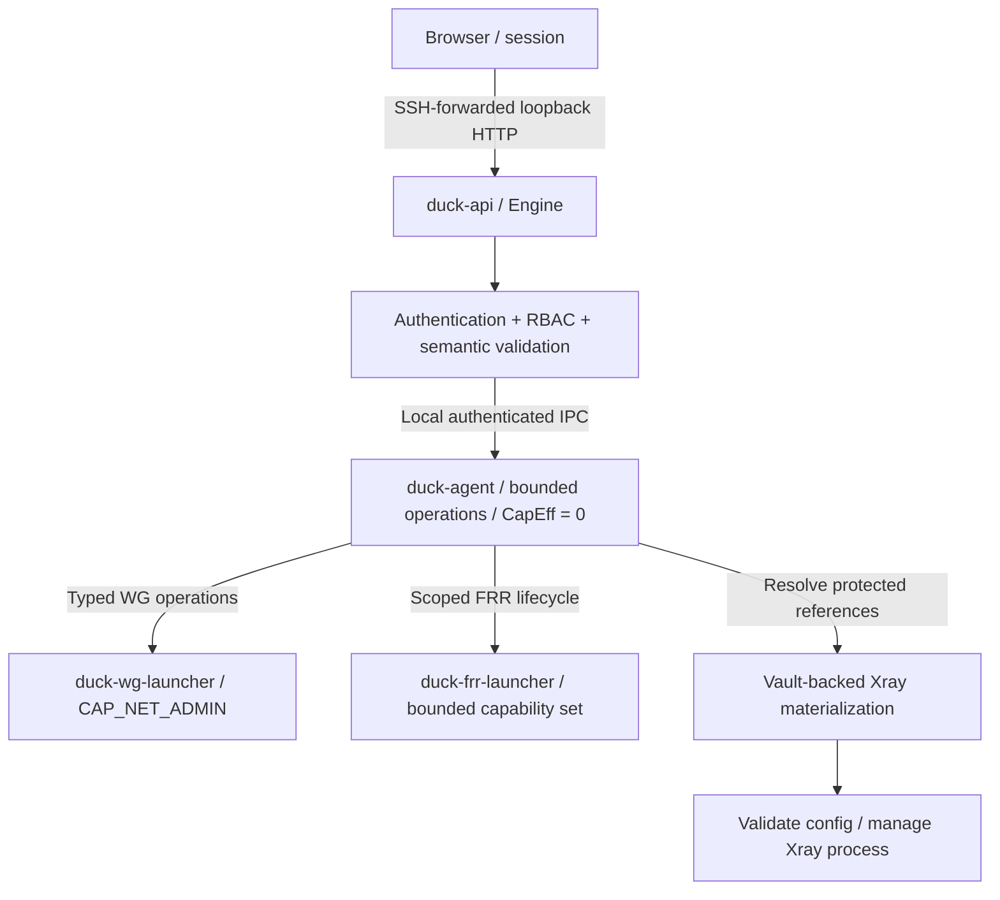
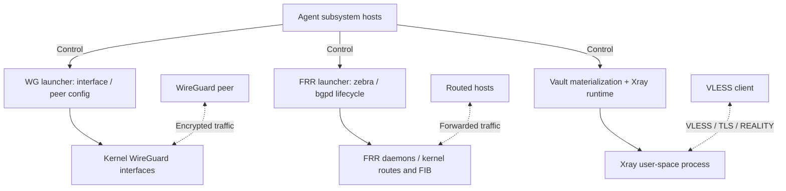
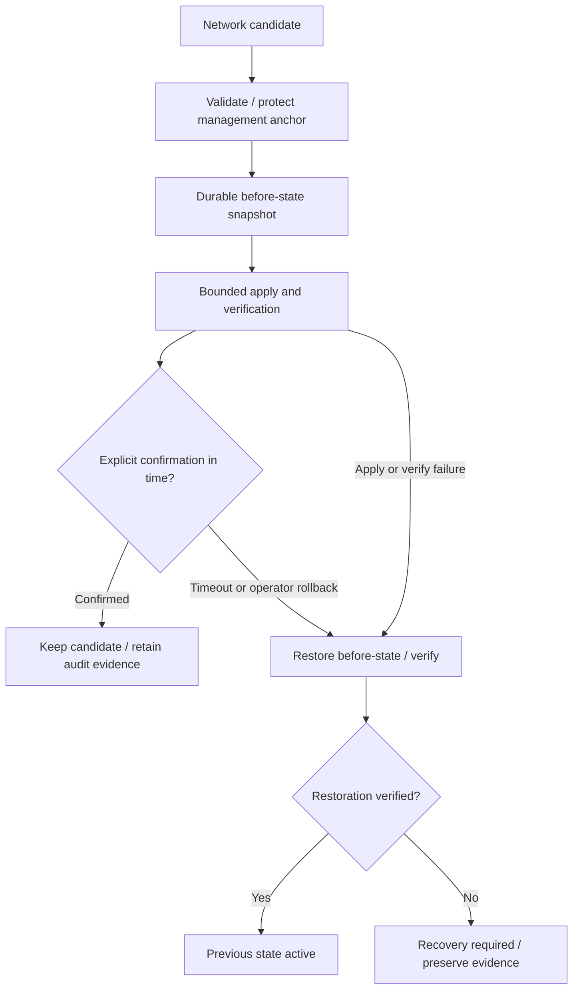

# Inside DuckOS

DuckOS beta.2 is a local Linux control plane on Debian 13. The diagrams below
show component relationships, not a claim that every catalog workflow is
qualified. See [current evidence](qualification-beta2.md) and [limitations](beta-limitations.md).

## One model, multiple entry points

Easy and Full modes are parallel views of the same model. The CLI is source-built
in beta.2, not an installed release-archive binary. This diagram describes ordinary
public management commands; offline root-only Owner recovery is a separate CLI
operation. The browser never accesses private Agent IPC.

## Management and privilege separation

Agent IPC is local and private. Zero effective capabilities does not make the
Agent an unprivileged application: its root identity and scoped filesystem
permissions remain part of the threat model. FRR and WireGuard do not have
identical grants; the FRR launcher has a broader bounded set for privilege
drop and daemon operations. Actual units are authoritative. See
[the security model](security-model.md) and [vulnerability reporting](../SECURITY.md).

## Control paths and packet paths differ

Solid arrows show selected control dependencies; dotted arrows illustrate
subsystem traffic. FRR updates the routing plane; ordinary forwarded packets
are handled by Linux, not by the API or a BGP web endpoint. Xray handles its
own user-space traffic. This is not a physical topology diagram or universal
packet route. Qualified beta.2 scenarios are listed in [the evidence summary](qualification-beta2.md).

## Safe Apply: operator actions and recovery

These are actions and outcomes, not a new state enum. The independent watchdog
and durable journal handle unconfirmed changes. Recovery failure is surfaced;
keep out-of-band access. Boot recovery is ordered before networkd to reconstruct
host routes/rules from durable evidence. See [Safe Apply](user/safe-apply.md)
and [recovery](user/recovery.md).
