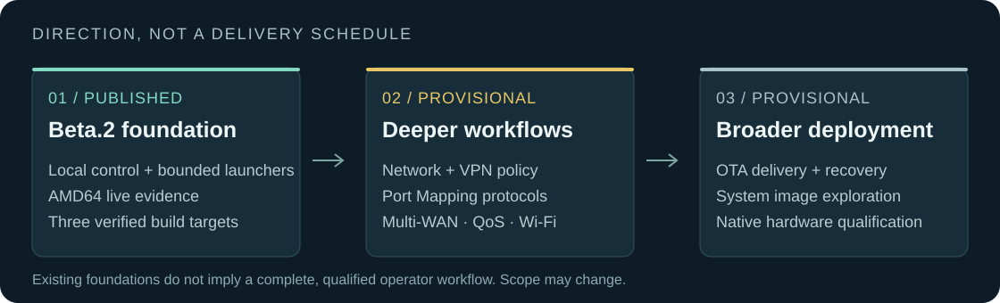

# DuckOS direction

**Provisional priorities, not a delivery schedule.** Beta.2 is the current
published prerelease. Planned work below is not a claim of existing support;
implementation, integration and qualification must each be established.
No beta.3 completion or release dates are promised.

## Published: v0.1.0-beta.2

Official AMD64, ARM64 and ARMv7 artifacts; two-node AMD64 live evidence;
WireGuard and Xray traffic scenarios; FRR H10; local identity/RBAC, Vault,
Safe Apply foundations, diagnostics, Speed Lab, Wake-on-LAN and Port Mapping
backend. ARM artifact verification does not establish equivalent live evidence.
See [release notes](release-notes.md), [qualification](qualification-beta2.md)
and [limitations](beta-limitations.md).

## Next directions: deeper operator workflows

| Direction | Work to develop and qualify |
|---|---|
| Port Mapping | Public UPnP IGD / SSDP, NAT-PMP and PCP protocol frontends; backend already ships |
| Core networking | WAN/LAN, DHCP/DNS and firewall workflow improvements, wider Safe Apply integration and evidence |
| VPN Center | Coherent VPN workflows, split tunneling and policy integration |
| Multi-WAN | Failover and policy routing workflows with controlled fault/recovery evidence |
| Traffic and QoS | Traffic monitoring, resource bounds and QoS/SQM workflows |
| Wi-Fi | Driver-aware management and native hardware qualification |

These areas include existing models or foundations as well as future work.
Their inclusion does not mean the complete public operator workflow ships today.
Priority and scope may change after design review and testing.

## Broader deployment: evidence before promises

- **OTA delivery:** build on signed offline update foundations; qualify trust,
  state preservation and rollback before a public delivery channel.
- **Recovery:** expand interruption, failure, power-loss and management-access
  evidence; retain explicit operator recovery paths.
- **System images:** explore bootable deployment artifacts beyond the current
  Debian-host installer; no image is promised by beta.2.
- **Hardware:** native ARM64/ARMv7, NIC and Wi-Fi coverage; physical board
  qualification remains separate from cross-build verification.

The local-first model, IPv4/IPv6 support, privilege separation, observable evidence
and management protection remain design constraints. Product scope and registered
choices are maintained in [the specification](product-spec-1.0.md) and [ADRs](adr/).
A mandatory cloud service or central controller is not part of this roadmap.
